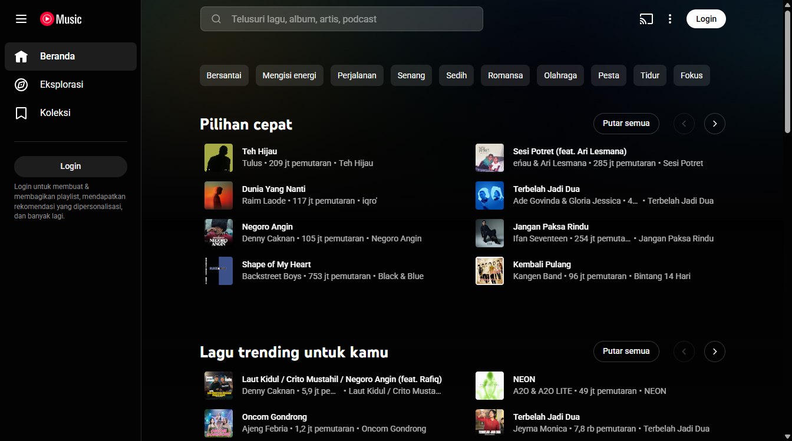
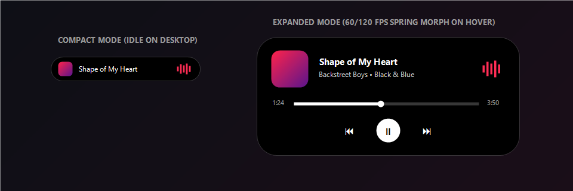

<div align="center">


# YouTube Music Desktop
### Native Windows Client • 100% Ad-Free • iPhone-Style Dynamic Island

[-0078D4?style=for-the-badge&logo=windows&logoColor=white)](https://github.com/ArisaAkiyama/ytm-desktop)
[](https://dotnet.microsoft.com/)
[](https://github.com/ArisaAkiyama/ytm-desktop)
[](https://github.com/ArisaAkiyama/ytm-desktop)

<p align="center">
  A fast, lightweight, native Windows desktop application for <b>YouTube Music</b>.<br/>
  Preserves the <b>100% official YouTube Music Web UI</b> while adding a multi-layer ad-blocking engine and a hardware-accelerated <b>Dynamic Island</b> overlay on your Windows desktop.
</p>

</div>

---

## 📸 Screenshots

### 1. Authentic YouTube Music Desktop Experience (Zero Ads & No Upgrade Clutter)
<div align="center">
  
</div>

### 2. Interactive Dynamic Island (Compact Pill & Expanded Media Controller)
<div align="center">
  
</div>

---

## ✨ Key Features

### 🛡️ 4-Layer Ad-Block & Stream Guard Engine
| Layer | Mechanism | Description |
| :--- | :--- | :--- |
| **Layer 1** | **Native Network Filter** | Intercepts & blocks ad, DoubleClick, PageAd, and tracking requests at the C# `CoreWebView2.WebResourceRequested` level before any payload is downloaded. |
| **Layer 2** | **InnerTube JSON Sanitizer** | Hooks `window.fetch` and `XMLHttpRequest` to strip `adPlacements`, `playerAds`, and `adSlots` directly from YouTube Music API responses. |
| **Layer 3** | **Stream Guard & Auto-Skip** | Monitors `<video>` playback in real time to instantly fast-forward unblocked ad streams and bypass *"Still watching?"* idle prompts for non-stop music. |
| **Layer 4** | **Cosmetic UI Cleaner** | Hides the *Upgrade* navigation tab, premium trial popups, and promotional banners while keeping the official layout intact. |

### 🏝️ iPhone-Style Dynamic Island for Windows
- **True Shared-Element Morphing (`60/120 FPS VSync`)**: Built on `CompositionTarget.Rendering` critically-damped spring physics (`0.0 → 1.0` progress driver) so the capsule, album art (`24px → 54px`), typography, and waveform morph seamlessly without layout snapping.
- **Smart Desktop-Only Visibility (*"Show Desktop"*)**: Automatically detects window Z-Order (`IsDesktopCurrentlyShown`) so the Dynamic Island appears **only on your Windows Desktop** when minimized and **never blocks active applications** like browsers or IDEs.
- **Full Media Controls & Live Equalizer**: Includes real-time 5-bar audio visualizer, interactive seek progress bar, track metadata with CJK/Unicode font fallback, and Previous / Play-Pause / Next buttons.

### 🖥️ Native Windows Integration
- **Immersive Dark Mode Title Bar**: Uses Win32 `DWMWA_USE_IMMERSIVE_DARK_MODE` (`#030303`) to blend seamlessly with YouTube Music's dark theme.
- **System Tray & Background Play**: Closing the main window minimizes the app smoothly to the Windows System Tray with a dark-themed context menu.
- **Adaptive Monitor Sizing**: Automatically scales to fit any screen resolution (`1366×768`, `1080p`, `1440p`, `4K`) with `PerMonitorV2` High-DPI awareness.

---

## 📂 Project Architecture

```text
ytm-desktop/
├── docs/assets/                 # Screenshots & visual documentation assets
├── src/YouTubeMusicDesktop/
│   ├── Assets/                  # Official multi-resolution icon (ytm.ico, 16px–256px)
│   ├── Interop/                 # Win32 DWM dark mode & Z-Order desktop detection (NativeMethods.cs)
│   ├── Models/                  # Real-time media telemetry payload (MediaPlaybackState.cs)
│   ├── Scripts/                 # 4-layer JS ad-blocker & player bridge (ytm-adblock-engine.js)
│   ├── Services/                # Native network request blocker & System Tray manager
│   ├── DynamicIslandWindow.xaml # VSync Shared-Element Morphing Dynamic Island UI
│   └── MainWindow.xaml          # Main WebView2 host window
├── Installer/
│   ├── YouTubeMusic.iss         # Inno Setup 6 installer configuration (English)
│   ├── build-installer.ps1      # Self-contained single-file publish & installer build script
│   └── assets/                  # Custom dark-themed Inno Setup wizard bitmaps
└── YouTubeMusicDesktop.sln
```

---

## 🚀 Installation & Building from Source

### Option 1: Universal Windows Installer (Recommended)
The installer is built as a **Self-Contained Single-File Deployment**, meaning **target PCs do NOT need .NET 8 pre-installed** (runs out-of-the-box on any 64-bit Windows 10 or Windows 11 PC and automatically verifies Microsoft Edge WebView2 Runtime).

To compile `dist/YouTubeMusic_Setup_v1.0.0.exe` yourself:
```powershell
powershell -ExecutionPolicy Bypass -File .\Installer\build-installer.ps1
```

### Option 2: Run from Source (Development)
**Prerequisites:** [**.NET 8.0 SDK**](https://dotnet.microsoft.com/download/dotnet/8.0)

```powershell
# Clone the repository
git clone https://github.com/ArisaAkiyama/ytm-desktop.git
cd ytm-desktop

# Build and run in Release mode
dotnet run --project src\YouTubeMusicDesktop\YouTubeMusicDesktop.csproj -c Release
```

---

## 🎮 Dynamic Island Interaction Guide

| Action | Behavior |
| :--- | :--- |
| **Hover Cursor over Pill** | Smoothly morphs from Compact Pill (`210×36`) to Expanded Media Card (`390×172`). |
| **Move Cursor Away** | Smoothly contracts back into the Compact Pill with zero bounce overshoot. |
| **Click Track Info / Art** | Restores and brings the main **YouTube Music Desktop** window to the foreground. |
| **Click / Drag Progress Bar** | Seeks directly to the selected timestamp in the current song. |
| **Close Main Window (`X`)** | Minimizes the app to the System Tray and activates the Dynamic Island on the Desktop. |

---

## 📄 Disclaimer & License

This project is an independent desktop client created for personal and educational use. **YouTube Music** and the YouTube Music logo are trademarks of **Google LLC**.
